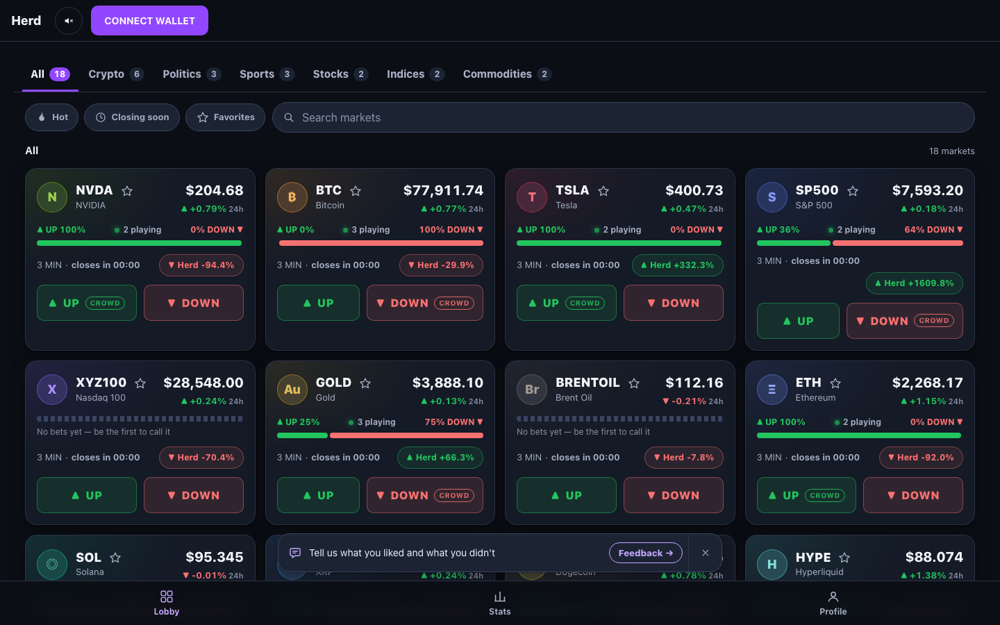
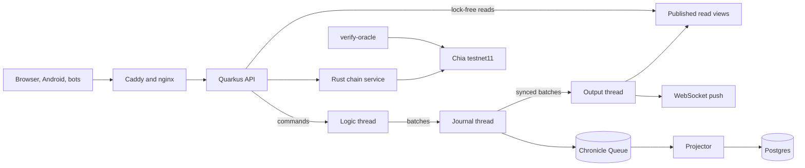

# Herd

A live crowd-versus-market trading game on Chia testnet11, built around an LMAX-style single-writer core, an event journal and round results anyone can verify on chain.

**[Live demo](https://playherd.app)** · [Architecture](docs/architecture/overview.md) · [Single-writer case study](docs/architecture/single-writer-pipeline.md) · [Design decisions](docs/architecture/decisions.md) · [Roadmap and known limits](ROADMAP.md)



## What it is

Players stake PLAY, a CAT on Chia testnet11, on whether a market ends a round up or down, with leverage up to the ceiling of that market. There are 18 markets in six categories: crypto, stocks, indices, commodities, politics and sports. Prices come directly from exchanges and Hyperliquid, and odds from Polymarket.

Two things set it apart from a plain prediction game:

- **The crowd trades in public.** Each market has a "herd" account that follows the majority and shows its profit and loss to everyone. It runs on paper execution at real prices.
- **Results can be checked.** The closing price and a hash of the full results of each settled round are written to Chia by an oracle singleton. [`tools/verify-oracle`](tools/verify-oracle/README.md) walks that record using only the public chain API and none of our keys. The oracle had reached record number 272,995 on testnet11 on 2026-11-01.

## What is worth reading

| Area | Where | Why it is interesting |
|---|---|---|
| Single-writer core | [`CoreWriter`](server/src/main/java/crowdvsmarket/server/core/CoreWriter.java), [`JournalStage`](server/src/main/java/crowdvsmarket/server/core/JournalStage.java), [`OutputStage`](server/src/main/java/crowdvsmarket/server/core/OutputStage.java) | Logic thread, journal thread and output thread. Nothing is answered before the batch is synced. |
| Failure handling | [`CoreWriterPipelineTest`](server/src/test/java/crowdvsmarket/server/core/CoreWriterPipelineTest.java) | A failed sync rolls back every unsynced batch. The death of each thread has its own test. |
| Architecture rule as a test | [`EngineIoRuleTest`](server/src/test/java/crowdvsmarket/server/core/EngineIoRuleTest.java) | A bytecode call-graph test that fails if the logic thread reaches the database, the network or the journal outside the rebuild path. |
| Event journal | [`ChronicleJournalStore`](server/src/main/java/crowdvsmarket/server/journal/ChronicleJournalStore.java) | Chronicle Queue with CRC32C on every record and void records for a failed write. Postgres is a projection fed from the journal. |
| Snapshots | [`SnapshotService`](server/src/main/java/crowdvsmarket/server/snapshot/SnapshotService.java) | Restart from snapshot plus journal tail, with a scheduled replay that compares state digests. |
| Chain service in Rust | [`chain/c2-svc`](chain/c2-svc), [`spend.rs`](chain/c2-svc/src/oracle/spend.rs) | Wallet signature checks and a durable queue of batched oracle spends on the Chia Rust SDK. |
| Public verifier | [`verify_oracle.py`](tools/verify-oracle/verify_oracle.py) | An outsider can hold the live site to account for its results. |

## Measured numbers

Every number has its conditions, and the two kinds below are not comparable with each other.

| Measurement | Result | Conditions |
|---|---|---|
| HTTP ceiling before the single writer: durable commit per bet under a shared lock | 25 bets/s pass, 50 bets/s fail | 100,000 seeded players, 8 server cores, `synchronous_commit=on`, [notes](docs/research/bench_ceiling_2026-10-20.md) |
| In-process writer before the three-stage pipeline | 65,000–66,000 bets/s | 1024 clients, closed loop, 10 s, Linux container on a virtual disk |
| In-process writer after it | 114,000–133,000 bets/s | Same setup, 4 runs, [notes](docs/research/writer_pipeline_2026-10-21.md) |
| Same comparison at 64–256 clients | No proven gain | Disk noise is larger than the difference |

HTTP throughput after the redesign has not been measured yet, and neither has the production disk. Both are on the [roadmap](ROADMAP.md).

## Architecture



The full walk-through is in [`docs/architecture/overview.md`](docs/architecture/overview.md).

## Stack

| Part | Technology |
|---|---|
| Game engine | Java 21, no framework, no I/O |
| Server | Quarkus 3.40, Chronicle Queue, PostgreSQL 16 |
| Chain service and CLI | Rust 1.98, Chia wallet SDK |
| Web and Android | React 19, TypeScript, Vite, Capacitor, WalletConnect with the Sage wallet |
| Operations | Docker Compose, Caddy, nginx, JFR events, Gatling and wrk2 load rigs |

The interface is available in six languages. Spanish, Chinese and Hindi are machine translations.

## Run it

You need Docker. The first start builds three images and takes a few minutes.

```bash
tools/stand.sh up       # database, chain service, server, web on :8480
tools/stand.sh status
tools/stand.sh down
```

The whole test suite needs JDK 21, Rust through `rustup`, Node and Docker:

```bash
make check
```

The last full run passed 9,844 Java tests with 6 skipped, plus the Rust and web suites. `make help` lists the other targets.

## Repository map

| Path | Contents |
|---|---|
| `engine/` | Pure game rules: rounds, liquidation, ledger, ratings |
| `server/` | API, single-writer core, journal, snapshots, market data, schedulers |
| `bots/` | 21 labelled bots that play by public trading rules |
| `chain/` | Rust chain service, CLI and simulator spike |
| `web/` | React client and the Android wrapper |
| `tools/` | Load rigs, stand scripts, audits, public verifier |
| `docs/` | Architecture notes in English, working notes in Russian: see the [index](docs/README.md) |

## Status

Herd is a working demo with a small test group, built to explore hard engineering problems end to end. The core is ahead of demand on purpose. [ROADMAP.md](ROADMAP.md) lists what is done, what is unproven and what comes next.

## License

[Apache-2.0](LICENSE). Security reports: see [SECURITY.md](SECURITY.md).
